# k8s-multi-tenant-platform

[](https://github.com/tenalisriharsha/k8s-multi-tenant-platform/actions/workflows/ci.yml)

A namespace-per-tenant multi-tenancy reference implementation for
Kubernetes, built entirely from upstream primitives — no service mesh, no
external policy engine. `tenantctl` is a CLI that onboards a new tenant end
to end: a dedicated namespace, a `ResourceQuota`, a `LimitRange`, deny-by-
default `NetworkPolicy` isolation, and scoped RBAC, applied as one
consistent bundle.

Why this matters: "give every team their own namespace" is easy to say and
easy to get wrong in the details — a missing default-deny policy, a quota
that doesn't actually bound memory limits, an RBAC role that lets a tenant
edit their own quota. This project pins down a working, tested version of
those details so it can be read end to end or dropped into a real cluster.

## Preview

| | |
|---|---|
| 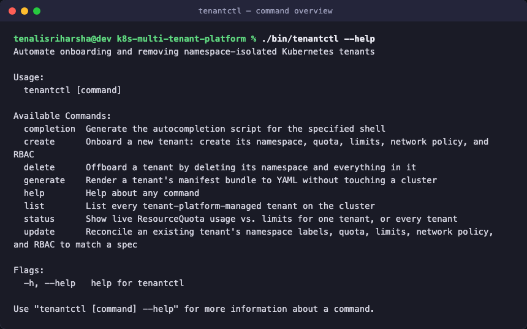 | 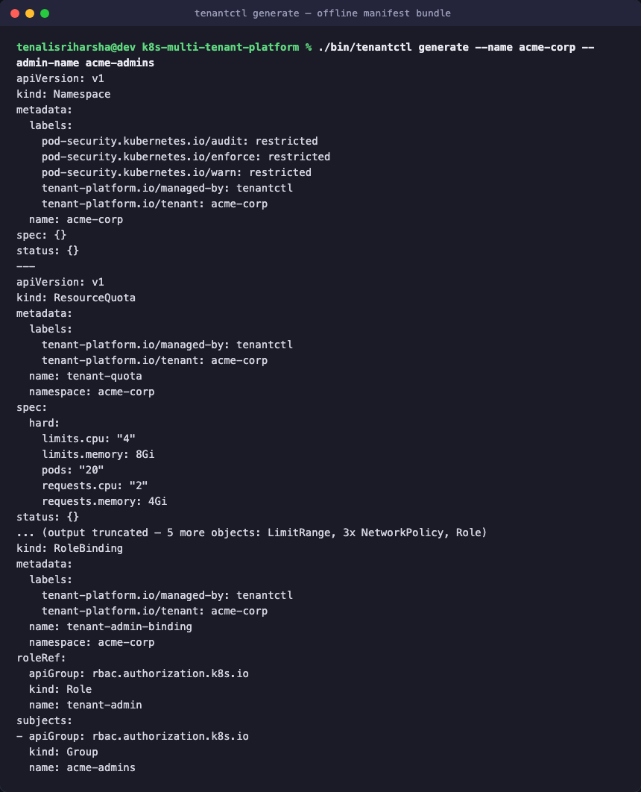 |
| `tenantctl --help` — the six-command CLI surface | `tenantctl generate` — the full manifest bundle, rendered offline |
| 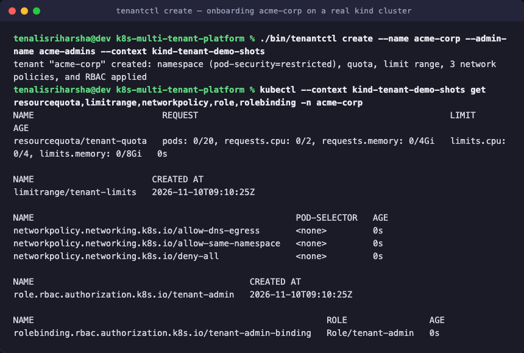 | 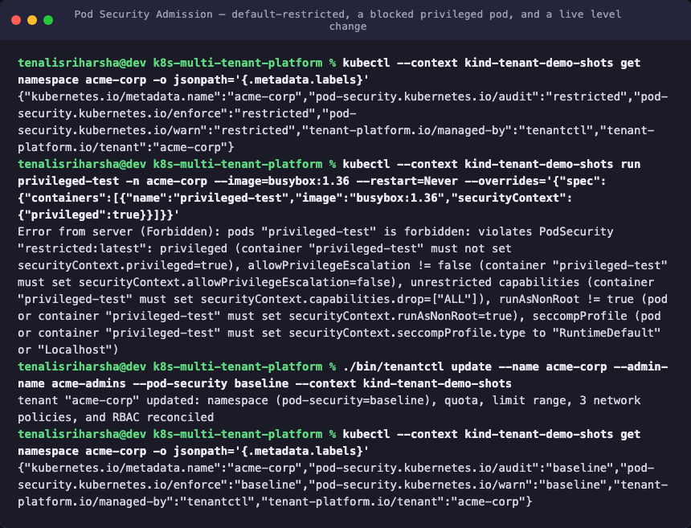 |
| `tenantctl create` onboarding `acme-corp` on a real `kind` cluster, verified with `kubectl` | Pod Security Admission: default-`restricted` namespace labels, a real privileged pod rejected, and `update` lowering the level live |
| 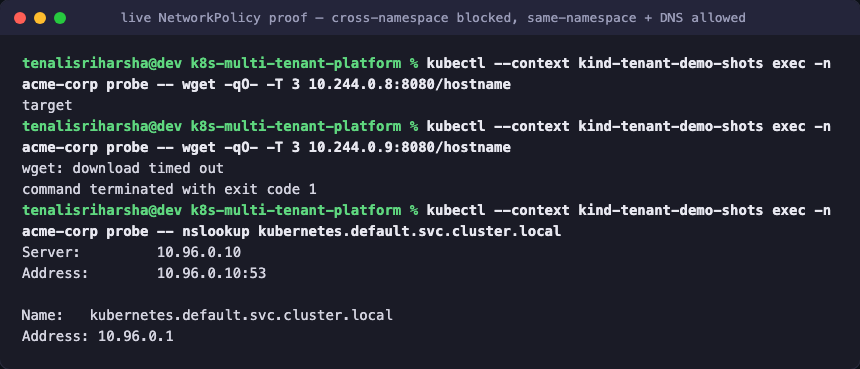 | 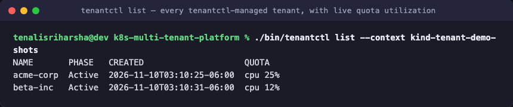 |
| Live proof against real pod traffic: cross-namespace blocked, same-namespace and DNS allowed | `tenantctl list` — every tenant with a live quota-utilization summary |
| 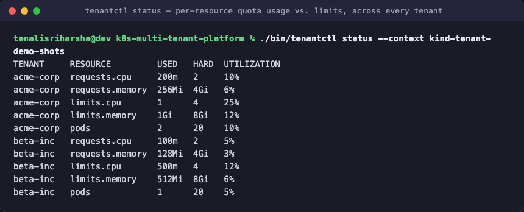 | 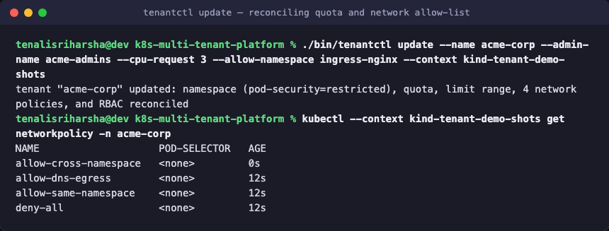 |
| `tenantctl status` — per-resource quota usage vs. limits, across every tenant | `tenantctl update` raising a quota and adding a cross-namespace allow-list to a live tenant |
| 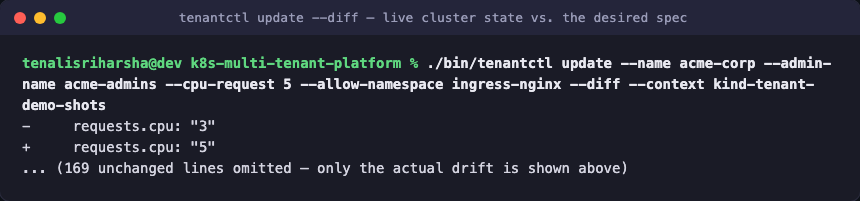 | 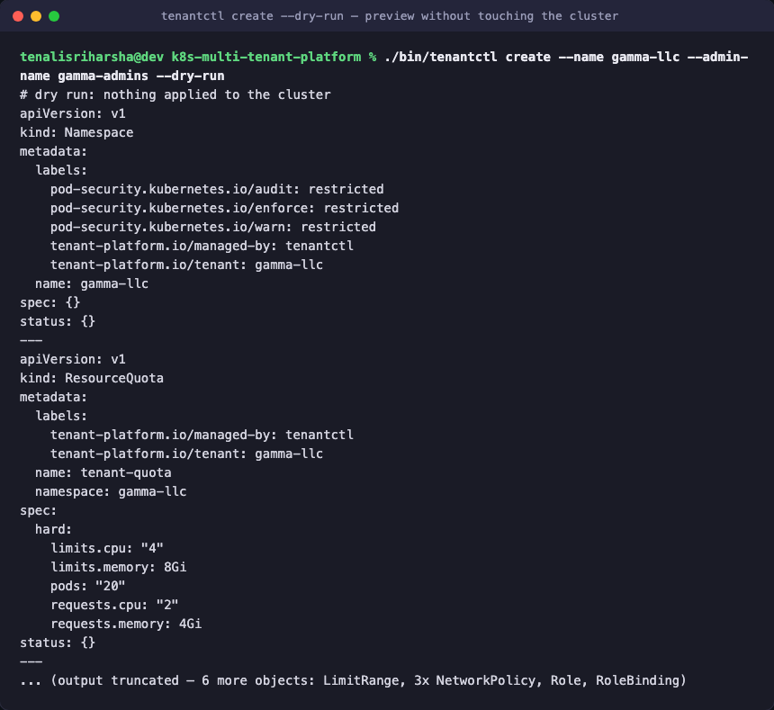 |
| `tenantctl update --diff` — live cluster state vs. the desired spec, with only the actual drift shown | `tenantctl create --dry-run` — preview the full bundle without touching the cluster |
| 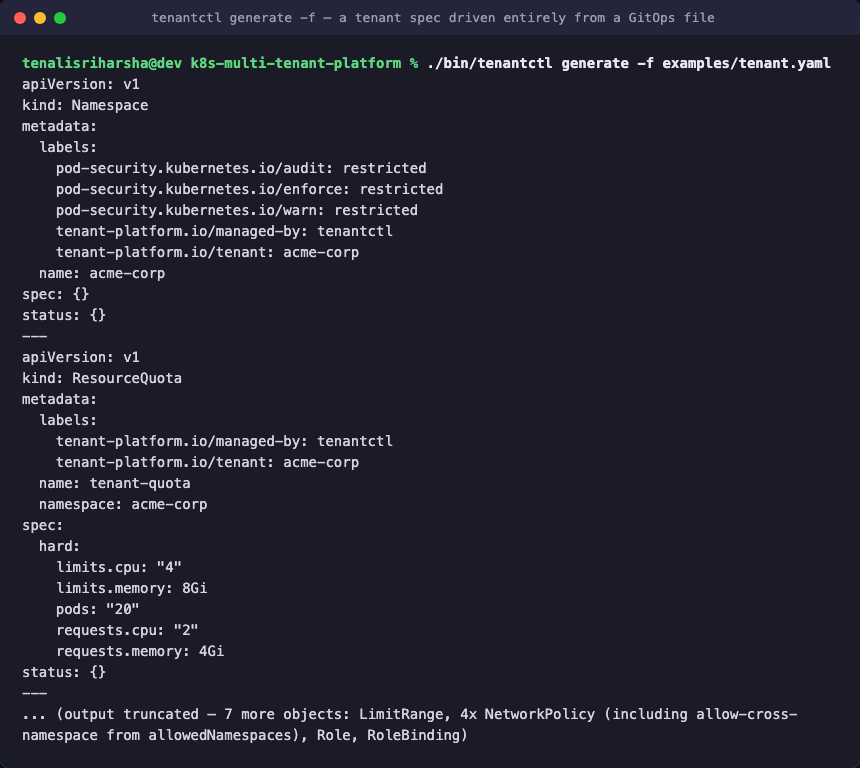 | 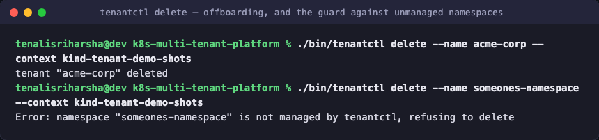 |
| `tenantctl generate -f` — a tenant spec driven entirely from a YAML file | `tenantctl delete`, plus the guard that refuses to delete a namespace it doesn't manage |
| 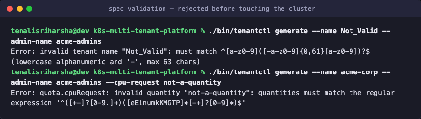 | |
| Spec validation rejects a bad name or an unparsable resource quantity before touching the cluster | |

## Quick start

Requires Go 1.27+.

```sh
git clone https://github.com/tenalisriharsha/k8s-multi-tenant-platform.git
cd k8s-multi-tenant-platform
go build -o bin/tenantctl ./cmd/tenantctl
./bin/tenantctl generate --name acme-corp --admin-name acme-admins
```

The command above renders the full tenant bundle to stdout — no cluster
required. To try it against a real cluster, point `tenantctl` at any
kubeconfig context, for example a local [kind](https://kind.sigs.k8s.io/)
cluster:

```sh
kind create cluster --name tenant-demo
./bin/tenantctl create --name acme-corp --admin-name acme-admins --context kind-tenant-demo
./bin/tenantctl list --context kind-tenant-demo
./bin/tenantctl status acme-corp --context kind-tenant-demo
./bin/tenantctl update --name acme-corp --admin-name acme-admins --cpu-request 3 --context kind-tenant-demo
./bin/tenantctl delete --name acme-corp --context kind-tenant-demo
```

Or run the same workflow end to end, including a real `kind` cluster
bring-up, with [`scripts/demo.sh`](scripts/demo.sh).

## What gets created

Running `create` for a tenant named `acme-corp` applies:

- **Namespace** `acme-corp`, labeled `tenant-platform.io/tenant=acme-corp`,
  `tenant-platform.io/managed-by=tenantctl`, and, by default,
  `pod-security.kubernetes.io/{enforce,audit,warn}=restricted` — the
  cluster's built-in Pod Security Admission controller then rejects any pod
  in the namespace that doesn't meet the `restricted` profile (privileged
  containers, missing `runAsNonRoot`, etc.), no extra policy engine needed
- **ResourceQuota** `tenant-quota` capping total CPU/memory requests and
  limits and the max pod count in the namespace
- **LimitRange** `tenant-limits` setting default per-container CPU/memory
  requests and limits for pods that don't specify their own
- **NetworkPolicy** `deny-all`, `allow-same-namespace`, and
  `allow-dns-egress` — ingress and egress are denied by default, then
  explicitly re-allowed for traffic within the namespace and for DNS
  resolution against `kube-system`. A fourth policy, `allow-cross-namespace`,
  is added automatically whenever `--allow-namespace` is set (see below)
- **Role** `tenant-admin` and **RoleBinding** `tenant-admin-binding`,
  scoping the tenant's admin subject to workload resources (pods,
  deployments, jobs, services, configmaps, secrets, ...) in their own
  namespace. The role deliberately excludes `resourcequotas`,
  `limitranges`, `networkpolicies`, `roles`, and `rolebindings`, so a
  tenant admin can't loosen the isolation boundary `tenantctl` just put in
  place.

## Commands

### `tenantctl generate`

Renders a tenant's manifest bundle as a multi-document YAML stream, without
contacting a cluster. Useful for review, or for piping into
`kubectl apply -f -`.

```sh
tenantctl generate --name acme-corp --admin-name acme-admins [--output bundle.yaml]
```

### `tenantctl create`

Builds the same bundle and applies it to a cluster. Fails with a clear
error if the tenant's namespace already exists.

```sh
tenantctl create --name acme-corp --admin-name acme-admins [--kubeconfig path] [--context name]
```

Add `--dry-run` to print the bundle that would be applied and exit without
contacting the cluster at all.

### `tenantctl update`

Reconciles an existing tenant's namespace labels (including its Pod
Security Admission level), quota, limit range, network policies, and RBAC
to match the given spec — the same flags (or `--file`) as `create`. The
namespace itself is never deleted or recreated, only its labels are
updated. Network policies are fully reconciled: one that's no longer
desired (e.g. a removed `--allow-namespace`) is deleted, not just left
behind. Fails if the tenant doesn't exist or isn't `tenantctl`-managed.

```sh
tenantctl update --name acme-corp --admin-name acme-admins --cpu-request 3 --context kind-tenant-demo
```

Add `--dry-run` to render the desired bundle without contacting the
cluster, or `--diff` to fetch the tenant's live state and print a
line-level diff against the desired spec (lines only in the live cluster
prefixed `-`, lines only in the desired spec prefixed `+`) without applying
anything.

```sh
tenantctl update --name acme-corp --admin-name acme-admins --cpu-request 5 --diff --context kind-tenant-demo
```

### `tenantctl delete`

Deletes a tenant's namespace, cascading deletion of everything in it.
Refuses to act on any namespace not labeled as `tenantctl`-managed.

```sh
tenantctl delete --name acme-corp [--kubeconfig path] [--context name]
```

### `tenantctl list`

Lists every `tenantctl`-managed tenant namespace, with phase, creation
time, and a one-line quota summary (its single most-utilized resource, e.g.
`memory 72%`). For the full per-resource breakdown, use `status`.

```sh
tenantctl list [--kubeconfig path] [--context name]
```

### `tenantctl status`

Reports live `ResourceQuota` usage against hard limits, per resource, as a
percentage. With no argument, reports every tenant; with a tenant name,
reports just that tenant and fails if it doesn't exist or isn't
`tenantctl`-managed. This is read-only and complements, rather than
duplicates, `update --diff`: `status` is about quota usage numbers,
`update --diff` is about full-bundle spec-vs-live drift.

```sh
tenantctl status [name] [--kubeconfig path] [--context name]
```

### Shared flags

`generate`, `create`, and `update` all build a tenant spec from these flags
(shown with their defaults):

| Flag | Default | Meaning |
|---|---|---|
| `--file`, `-f` | | Load the full spec from a YAML file instead of the flags below (GitOps mode) |
| `--name` | *(required unless `--file`)* | Tenant name; must be a valid DNS label |
| `--cpu-request` | `2` | Total CPU requests allowed in the namespace |
| `--memory-request` | `4Gi` | Total memory requests allowed in the namespace |
| `--cpu-limit` | `4` | Total CPU limits allowed in the namespace |
| `--memory-limit` | `8Gi` | Total memory limits allowed in the namespace |
| `--max-pods` | `20` | Maximum pods allowed in the namespace |
| `--default-cpu-request` | `100m` | Per-container default CPU request |
| `--default-memory-request` | `128Mi` | Per-container default memory request |
| `--default-cpu-limit` | `500m` | Per-container default CPU limit |
| `--default-memory-limit` | `512Mi` | Per-container default memory limit |
| `--allow-namespace` | | Additional namespace allowed bidirectional NetworkPolicy traffic with this tenant (repeatable), e.g. a shared ingress controller namespace |
| `--pod-security` | `restricted` | Pod Security Admission level enforced on the tenant namespace: `privileged`, `baseline`, `restricted`, or `none` to disable |
| `--admin-kind` | `Group` | RBAC subject kind: `User`, `Group`, or `ServiceAccount` |
| `--admin-name` | *(required unless `--file`)* | RBAC subject name bound as tenant admin |
| `--admin-namespace` | | Required when `--admin-kind=ServiceAccount` |

When `--file` is set, the other spec flags above are ignored. See
[`examples/tenant.yaml`](examples/tenant.yaml) for the file format — its
keys mirror the flags above (`quota.cpuRequest`, `limitRange.defaultCPULimit`,
`allowedNamespaces`, `podSecurityLevel`, `adminSubject.kind`, ...). Unlike
the flags, an omitted `podSecurityLevel` in a file means no PodSecurity
labels at all, not the `restricted` default — GitOps specs are explicit.

`create`, `update`, `delete`, `list`, and `status` additionally accept
`--kubeconfig` and `--context` to target a specific cluster and context.

## Architecture

`internal/tenant` builds Kubernetes API objects from a plain `Spec` struct
(no cluster access), and applies them through a thin wrapper over
`kubernetes.Interface` so the apply/update/delete/list/diff logic can be
tested against a fake clientset. `cmd/tenantctl` wires that package to a
Cobra CLI. See [PROGRESS.md](PROGRESS.md) for the full design rationale and
the phased build plan.

```
cmd/tenantctl/       CLI entrypoint and subcommands
internal/tenant/     Spec validation, manifest builders, YAML rendering, cluster client
examples/            Sample GitOps tenant spec file for `--file`
scripts/             Local dev helpers: kind cluster bring-up, a full CLI demo, screenshot capture
docs/screenshots/    Preview images used above
```

One tenant's isolation boundary, as applied by `create` (or reconciled by
`update`):

```
                              kubeconfig context
                                     │
                                     ▼
                            ┌─────────────────┐
                            │    tenantctl     │
                            └────────┬─────────┘
                                     │ apply/reconcile
                                     ▼
 ┌───────────────────────────────────────────────────────────────────┐
 │ Namespace "acme-corp"                                              │
 │ pod-security.kubernetes.io/{enforce,audit,warn}=restricted         │
 │                                                                    │
 │  ┌───────────────┐  ┌───────────────┐  ┌───────────────────────┐  │
 │  │ ResourceQuota │  │  LimitRange   │  │   Role + RoleBinding   │  │
 │  │ caps CPU/mem/ │  │ per-container │  │  scopes an admin       │  │
 │  │ pod count     │  │ defaults      │  │  subject to this       │  │
 │  └───────────────┘  └───────────────┘  │  namespace only        │  │
 │                                         └───────────────────────┘  │
 │  NetworkPolicy: deny-all, then allow-same-namespace +              │
 │  allow-dns-egress (+ allow-cross-namespace if --allow-namespace)   │
 │                                                                    │
 │        ✗ cross-namespace traffic        ✓ same-namespace traffic   │
 │        ✗ privileged/root pods           ✓ DNS to kube-system       │
 └───────────────────────────────────────────────────────────────────┘
```

Every object above is built from the same `Spec` by `internal/tenant.Build`,
so `generate`, `create`, and `update` always apply byte-identical output for
the same spec — there's no separate code path per command that could drift.

### Troubleshooting

- **A pod won't schedule, and `kubectl describe pod` shows a `PodSecurity`
  admission error** (`violates PodSecurity "restricted:latest"`, missing
  `runAsNonRoot`, `allowPrivilegeEscalation`, `seccompProfile`, or dropped
  capabilities). This is expected: the tenant's namespace defaults to the
  `restricted` Pod Security Admission level. Either fix the pod's
  `securityContext` to comply (the usual fix — see the Kubernetes
  [Pod Security Standards](https://kubernetes.io/docs/concepts/security/pod-security-standards/)),
  or lower the tenant's level with
  `tenantctl update --pod-security baseline` (or `none` to disable PSA
  labels entirely, not recommended for production tenants).

- **`tenantctl create`/`update`/`delete`/`status` fails with `"namespace
  ... is not managed by tenantctl"` or `"not tenantctl-managed"`.** The
  namespace exists but is missing the
  `tenant-platform.io/managed-by=tenantctl` label — either it wasn't
  created by `tenantctl` (a hand-created or pre-existing namespace that
  happens to share the tenant's name), or the label was manually removed.
  `tenantctl` refuses to act on it rather than guess; rename the tenant or
  relabel the namespace deliberately if it's actually meant to be managed.

- **`tenantctl status`/`list` shows `no quota data` or a `-` instead of
  usage numbers.** The tenant's `ResourceQuota` hasn't been populated by
  the cluster's quota controller yet — normal for a few seconds right
  after `create`, since Kubernetes computes `.status.used` asynchronously.
  Re-run the command; this is never treated as an error so one tenant's
  transient gap doesn't fail the whole fleet view.

- **Pods between two tenants, or between a tenant and a shared namespace
  like an ingress controller, can't reach each other.** Confirm the
  traffic is actually allowed: same-namespace traffic and DNS to
  `kube-system` are allowed by default, but everything else — including
  traffic to another tenant — is denied by the `deny-all` policy unless
  the target namespace is in `--allow-namespace`
  (`allow-cross-namespace` policy). Check
  `kubectl get networkpolicy -n <tenant>` and `tenantctl update --diff` to
  see what's actually applied versus what the spec intends.

- **`tenantctl update --diff` shows unexpected noise on every run, even
  when nothing changed.** This should not happen — `DiffTenant` already
  strips API-server bookkeeping (`resourceVersion`, `uid`,
  `managedFields`, the namespace's injected `kubernetes.io/metadata.name`
  label, etc.) before comparing. If you see persistent noise, it's worth
  filing as a bug rather than working around.

## Development

```sh
go build ./...
go vet ./...
go test ./... -cover
```

Try the full workflow against a real cluster:

```sh
./scripts/kind-up.sh        # bring up (or reuse) a local kind cluster
./scripts/demo.sh           # build tenantctl and run create/list/update/diff/delete against it
```

## Status

Actively in development. [PROGRESS.md](PROGRESS.md) tracks the
architecture, the phased build plan, and exactly what's done versus planned
next.

## License

MIT — see [LICENSE](LICENSE).
