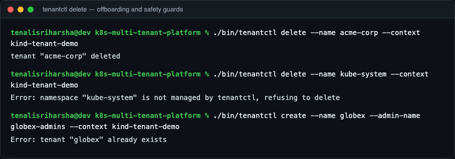
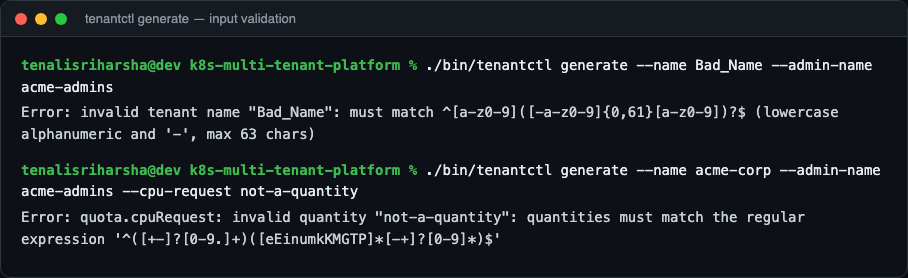

# k8s-multi-tenant-platform

[](https://github.com/tenalisriharsha/k8s-multi-tenant-platform/actions/workflows/ci.yml)

A namespace-per-tenant multi-tenancy reference implementation for
Kubernetes, built entirely from upstream primitives — no service mesh, no
external policy engine. `tenantctl` is a CLI that onboards a new tenant end
to end: a dedicated namespace, a `ResourceQuota`, a `LimitRange`, deny-by-
default `NetworkPolicy` isolation, and scoped RBAC, applied as one
consistent bundle.

Why this matters: "give every team their own namespace" is easy to say and
easy to get wrong in the details — a missing default-deny policy, a quota
that doesn't actually bound memory limits, an RBAC role that lets a tenant
edit their own quota. This project pins down a working, tested version of
those details so it can be read end to end or dropped into a real cluster.

## Preview

| | |
|---|---|
|  |  |
| `tenantctl --help` — the four-command CLI surface | `tenantctl generate` — the full manifest bundle, rendered offline |
|  |  |
| `tenantctl create` onboarding `acme-corp` on a real `kind` cluster, verified with `kubectl` | `tenantctl list` after onboarding a second tenant |
|  |  |
| Live proof against real pod traffic: cross-namespace blocked, same-namespace and DNS allowed | `tenantctl delete`, plus the guard that refuses to delete a namespace it doesn't manage |
|  | |
| Spec validation rejects a bad name or an unparsable resource quantity before touching the cluster | |

## Quick start

Requires Go 1.27+.

```sh
git clone https://github.com/tenalisriharsha/k8s-multi-tenant-platform.git
cd k8s-multi-tenant-platform
go build -o bin/tenantctl ./cmd/tenantctl
./bin/tenantctl generate --name acme-corp --admin-name acme-admins
```

The command above renders the full tenant bundle to stdout — no cluster
required. To try it against a real cluster, point `tenantctl` at any
kubeconfig context, for example a local [kind](https://kind.sigs.k8s.io/)
cluster:

```sh
kind create cluster --name tenant-demo
./bin/tenantctl create --name acme-corp --admin-name acme-admins --context kind-tenant-demo
./bin/tenantctl list --context kind-tenant-demo
./bin/tenantctl delete --name acme-corp --context kind-tenant-demo
```

## What gets created

Running `create` for a tenant named `acme-corp` applies:

- **Namespace** `acme-corp`, labeled `tenant-platform.io/tenant=acme-corp`
  and `tenant-platform.io/managed-by=tenantctl`
- **ResourceQuota** `tenant-quota` capping total CPU/memory requests and
  limits and the max pod count in the namespace
- **LimitRange** `tenant-limits` setting default per-container CPU/memory
  requests and limits for pods that don't specify their own
- **NetworkPolicy** `deny-all`, `allow-same-namespace`, and
  `allow-dns-egress` — ingress and egress are denied by default, then
  explicitly re-allowed for traffic within the namespace and for DNS
  resolution against `kube-system`
- **Role** `tenant-admin` and **RoleBinding** `tenant-admin-binding`,
  scoping the tenant's admin subject to workload resources (pods,
  deployments, jobs, services, configmaps, secrets, ...) in their own
  namespace. The role deliberately excludes `resourcequotas`,
  `limitranges`, `networkpolicies`, `roles`, and `rolebindings`, so a
  tenant admin can't loosen the isolation boundary `tenantctl` just put in
  place.

## Commands

### `tenantctl generate`

Renders a tenant's manifest bundle as a multi-document YAML stream, without
contacting a cluster. Useful for review, or for piping into
`kubectl apply -f -`.

```sh
tenantctl generate --name acme-corp --admin-name acme-admins [--output bundle.yaml]
```

### `tenantctl create`

Builds the same bundle and applies it to a cluster. Fails with a clear
error if the tenant's namespace already exists.

```sh
tenantctl create --name acme-corp --admin-name acme-admins [--kubeconfig path] [--context name]
```

### `tenantctl delete`

Deletes a tenant's namespace, cascading deletion of everything in it.
Refuses to act on any namespace not labeled as `tenantctl`-managed.

```sh
tenantctl delete --name acme-corp [--kubeconfig path] [--context name]
```

### `tenantctl list`

Lists every `tenantctl`-managed tenant namespace, with phase and creation
time.

```sh
tenantctl list [--kubeconfig path] [--context name]
```

### Shared flags

`generate` and `create` both build a tenant spec from these flags (shown
with their defaults):

| Flag | Default | Meaning |
|---|---|---|
| `--name` | *(required)* | Tenant name; must be a valid DNS label |
| `--cpu-request` | `2` | Total CPU requests allowed in the namespace |
| `--memory-request` | `4Gi` | Total memory requests allowed in the namespace |
| `--cpu-limit` | `4` | Total CPU limits allowed in the namespace |
| `--memory-limit` | `8Gi` | Total memory limits allowed in the namespace |
| `--max-pods` | `20` | Maximum pods allowed in the namespace |
| `--default-cpu-request` | `100m` | Per-container default CPU request |
| `--default-memory-request` | `128Mi` | Per-container default memory request |
| `--default-cpu-limit` | `500m` | Per-container default CPU limit |
| `--default-memory-limit` | `512Mi` | Per-container default memory limit |
| `--admin-kind` | `Group` | RBAC subject kind: `User`, `Group`, or `ServiceAccount` |
| `--admin-name` | *(required)* | RBAC subject name bound as tenant admin |
| `--admin-namespace` | | Required when `--admin-kind=ServiceAccount` |

`create`, `delete`, and `list` additionally accept `--kubeconfig` and
`--context` to target a specific cluster and context.

## Architecture

`internal/tenant` builds Kubernetes API objects from a plain `Spec` struct
(no cluster access), and applies them through a thin wrapper over
`kubernetes.Interface` so the apply/delete/list logic can be tested against
a fake clientset. `cmd/tenantctl` wires that package to a Cobra CLI. See
[PROGRESS.md](PROGRESS.md) for the full design rationale and the phased
build plan.

```
cmd/tenantctl/     CLI entrypoint and subcommands
internal/tenant/    Spec validation, manifest builders, YAML rendering, cluster client
docs/screenshots/    Preview images used above
```

## Development

```sh
go build ./...
go vet ./...
go test ./... -cover
```

## Status

Actively in development. [PROGRESS.md](PROGRESS.md) tracks the
architecture, the phased build plan, and exactly what's done versus planned
next.

## License

MIT — see [LICENSE](LICENSE).
